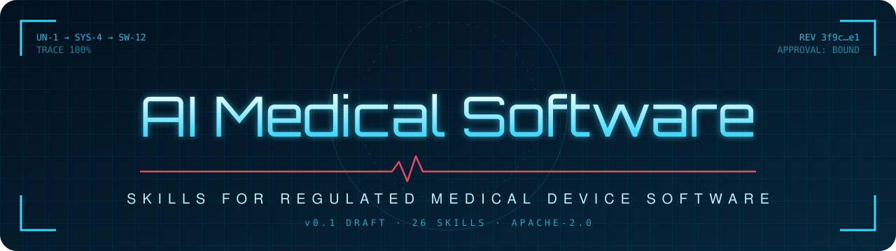

<p align="center">
  
</p>

# Skills for regulated medical device software

Agent skills for building medical device software and SaMD, traceable by design, and for the software around it that is not a device.

Software in a medical device is built under design controls, risk management, a defined software lifecycle and human accountability for every decision that matters. These skills let an AI coding agent work inside that discipline: it drafts the records, keeps them linked from user need to test result, and stops wherever a person has to decide. Claude Code enforces those stops for typed commands; other agents only read them as instructions, so pair them with host-enforced review (evidence level 1 or above).

Scope: EU and US rules. They support your design control work. They do not make you compliant, they are not a QMS, and nothing here is legal or regulatory advice.

| Useful for | Not for |
| --- | --- |
| Software teams at medical device and SaMD manufacturers that already have a QMS and a QA/RA owner | Replacing your QMS, eQMS or regulatory function |
| Drafting needs, requirements, specifications, risk and verification records with the agent, linked and hash-approved | In vitro diagnostics (IVDR is out of scope in this version) |
| Retrofitting records onto existing code, including the IEC 62304 legacy software route | Clinical evaluation, which a person leads; the skills only point to it |
| Software that is not itself a device: components supplied to device makers, QMS tools, health and wellness software. `intake` records that, and the skills run at the depth your plan chooses | Deciding a class for you: nothing is classified by default |

> [!IMPORTANT]
> **Draft, read before adopting.** No named person has reviewed the skills yet; they have been tested with language models. Check every regulatory statement against the source it cites before you rely on it.

## Before you start

- **Approval to use an AI agent on this product**, under your QMS: which tool and model, where code and records are processed, how output is reviewed. Software used in the QMS is validated before use (ISO 13485 4.1.6). `/setup` asks for the reference.
- **A person who owns QA/RA decisions.** The skills draft; that person approves.
- **A pinned version.** Install a tag, not the moving branch, and record it in your configuration items. Moving to a new tag is a change to a tool your QMS validated: re-validate before use.

## Installation

Pin a tag: clone it, then install from the clone.

```bash
git clone --branch v0.1.0-draft.3 --depth 1 https://github.com/miguelangeloazevedo/regulated-dev-skills ~/rds
```

<details open>
<summary><b>Claude Code (recommended: the validator updates with the skills)</b></summary>

```bash
claude plugin marketplace add ~/rds
claude plugin install regulated-dev-skills
```

</details>

<details>
<summary><b>Any other agent (Codex, Copilot, Cursor, Gemini, ...)</b></summary>

```bash
npx skills@1.7.2 add ~/rds   # skills.sh CLI, the version tested; it asks which agent to install for
```

Copies editable files into your project. Take `setup`: it carries the validator. To update, clone the new tag and re-run.

</details>

<details>
<summary><b>By hand</b></summary>

Copy the folders under `~/rds/skills/<group>/` into your agent's skills directory (for example `.claude/skills/`, `.agents/skills/` for Codex, or the directory your agent's documentation names). Each skill is one folder with a `SKILL.md`; rules-only agents can load the `SKILL.md` text as a rule.

</details>

### Then, in your agent

**`/setup`**, once per repository. It asks four questions (record backend, evidence level, roles, where records live), copies the validator into `tools/rds/`, and adds a block like this to `AGENTS.md` or `CLAUDE.md`:

```yaml
rds_version: 1
backend: standalone        # where records live
evidence_level: 1          # 0 files in git, 1 host-enforced review, 2 signed approvals, 3 validated record system
roles_file: quality/roles.yml
artefacts_dir: quality
jurisdictions: [eu, us]
# safety_class is absent until a person decides it through /intake: then A, B, C, none, or a map per system
```

**`/intake`** works out what each module is before any work starts: a device, not a device, part of someone else's device, or not decided yet. For device software it then proposes the risk class, the IEC 62304 software safety class and the rules that apply (EU MDR, FDA, AI Act, cybersecurity, usability). Every answer comes with its rule path; a person decides and records it with `/approve`. Nothing is classified by default.

After that the agent reaches for the lifecycle skills as the work calls for them. **Typed** skills are the ones only a person starts: `/setup`, `/intake`, `/approve`, `/release`, `/impact`, `/status`.

See the output first: a [releasable class A example](examples/minimal-release/README.md) that passes the release gate, and a [class B example](examples/infusion-rate-check/README.md) that fails it and says why. The whole map is in [FLOWS.md](FLOWS.md).

### The smallest path

For a first change, in this order. Typed commands you type; the others you ask for by name ("use `requirements`") or let the agent pick.

1. `/setup`, `/intake`, then `development-plan`.
2. `user-needs`, `requirements`, with `risk` alongside; `/approve` the requirements.
3. `specifications`; `/approve` them. Then `implement` and `unit-verification` per unit, and `verify`.
4. `traceability` and `configuration-management` throughout; `usability` from the use specification onwards, `validation` at the end.
5. `/approve` what remains, then `/release`.

### Class A and software that is not a device

The chain is the same; the depth is smaller. At class A, `specifications` ties code to requirements without an architecture, `unit-verification` is not required, and `verify` runs system testing only (see [CLASS-OBLIGATIONS.md](skills/gates/intake/CLASS-OBLIGATIONS.md)). For software that is not a device, the development plan chooses the depth and QA/RA accepts it. The [class A example](examples/minimal-release/README.md) shows the smallest record set that passes the release gate.

### Words used here

- **Typed skill**: one only a person starts, by typing `/name`. In Claude Code the agent cannot fire it; other agents may not enforce that, so each typed skill also states it must not run unprompted.
- **Backend**: where records live. This version implements `standalone` (markdown files in git); the others are a documented contract without an adapter yet.
- **Evidence level**: this repository's own document-control tier, not a regulatory term: 0 files in git, 1 declared host review, 2 declared signatures, 3 a record system you validated. The validator does not verify 1 and 2 against the host. None of them is a Part 11 claim.
- **Safety class**: the IEC 62304 software safety class, for device software only. Never filled in by default.

## How it works

- **Records, linked upward.** Need, system requirement, software requirement, specification, test, result. One markdown file each. Coverage is computed from the links, never typed.
- **Approval bound to content.** An approval names a person, a role and the revision hash of what they saw. Edit a word and the approval goes stale on its own.
- **Agents draft, people decide.** Approve and release are typed commands. Residual-risk acceptance is a person's call.
- **Human-signed verification (this repository's rule).** Models may run the verification; at software safety class B and C a named person independent of the build signs each result, or a report listing them, bound to the result's hash. Without it the result is a pre-check. The standard asks for verification, not this signature; the rule is stricter on purpose.
- **Evidence levels 0 to 3.** The project says what its controls prove; the skills never claim more.

Details: [spec/](spec/README.md). In a project, check the records with `python3 tools/rds/validate.py records quality --report`.

## Reference

**27**<!--count:skills--> skills: **18**<!--count:skills-model--> the agent can reach for, **9**<!--count:skills-typed--> you type.

### The lifecycle

Plan, needs, requirements, specifications, units, validation, review, problems, maintenance, at the depth the safety class or the plan asks for.

- **[development-plan](docs/lifecycle/development-plan.md)** (model): Writes the software development plan the rest of the chain runs on: stages, reviews, verification and validation activities, responsibilities, the risk management plan, and the configuration management plan. [Skill](skills/lifecycle/development-plan/SKILL.md)
- **[user-needs](docs/lifecycle/user-needs.md)** (model): Writes the user needs the design answers to: who must be able to do what, and why, within the intended purpose `intake` fixed. [Skill](skills/lifecycle/user-needs/SKILL.md)
- **[requirements](docs/lifecycle/requirements.md)** (model): Derives system requirements from user needs and software requirements from system requirements, with risk controls folded in. [Skill](skills/lifecycle/requirements/SKILL.md)
- **[specifications](docs/lifecycle/specifications.md)** (model): Says how each software requirement is built, at the depth the safety class asks for: architecture and software items for class B and C, detailed design per unit for class C. [Skill](skills/lifecycle/specifications/SKILL.md)
- **[implement](docs/lifecycle/implement.md)** (model): Builds one software unit from its specification and hands it to unit verification. [Skill](skills/lifecycle/implement/SKILL.md)
- **[unit-verification](docs/lifecycle/unit-verification.md)** (model): Verifies each software unit against acceptance criteria derived from its specification, test-first, by the methods the class asks for. [Skill](skills/lifecycle/unit-verification/SKILL.md)
- **[validation](docs/lifecycle/validation.md)** (model): Validates that the finished product meets its user needs and intended use (ISO 13485 7.3.7) by the method each need calls for: summative usability results, simulated use, clinical data through the clinical evaluation, or analysis. [Skill](skills/lifecycle/validation/SKILL.md)
- **[design-review](docs/lifecycle/design-review.md)** (model): Prepares and records a design review at a stage the plan names: what was read, by whom, what was found, and whether the design can meet its requirements. [Skill](skills/lifecycle/design-review/SKILL.md)
- **[problem-resolution](docs/lifecycle/problem-resolution.md)** (model): Takes a problem from report to verified fix: records it, builds a loop that reproduces it, assesses its safety relevance, raises a change request, fixes it, and checks the fix. [Skill](skills/lifecycle/problem-resolution/SKILL.md)
- **[maintenance](docs/lifecycle/maintenance.md)** (model): Keeps released software safe: plans maintenance, takes in feedback and complaints, monitors SOUP, sends problems through `problem-resolution` and changes through the chain, and feeds post-market surveillance. [Skill](skills/lifecycle/maintenance/SKILL.md)
- **[usability](docs/lifecycle/usability.md)** (model): Runs the usability engineering process of IEC 62366-1 from the start of development: use specification, safety-related user interface characteristics, hazard-related use scenarios, user interface specification, formative evaluation during design and summative evaluation at the end. [Skill](skills/lifecycle/usability/SKILL.md)

### Regulated

These run alongside every step.

- **[traceability](docs/regulated/traceability.md)** (model): Keeps the chain from user need to verification intact and measured. [Skill](skills/regulated/traceability/SKILL.md)
- **[risk](docs/regulated/risk.md)** (model): Supports the risk management process by drafting hazards, risk estimates, controls and residual risk evaluations. [Skill](skills/regulated/risk/SKILL.md)
- **[security-diligence](docs/regulated/security-diligence.md)** (model): Security work built into the development process: a threat model that follows the architecture, analysis of dependencies and code, a decision on every open finding, and a correction loop back to build. [Skill](skills/regulated/security-diligence/SKILL.md)
- **[verify](docs/regulated/verify.md)** (model): Runs integration and system testing on the exact revision and keeps verification apart from validation. [Skill](skills/regulated/verify/SKILL.md)
- **[package](docs/regulated/package.md)** (model): Builds the design and development file index from approved records and verification results, not from memory. [Skill](skills/regulated/package/SKILL.md)
- **[configuration-management](docs/regulated/configuration-management.md)** (model): Keeps the software and everything that builds it identified, changed only through approved change requests, and recoverable as baselines. [Skill](skills/regulated/configuration-management/SKILL.md)

### Gates

Typed commands. A person decides; the agent never fires these.

- **[setup](docs/gates/setup.md)** (typed): Writes the project block and the few files the other skills need. [Skill](skills/gates/setup/SKILL.md)
- **[intake](docs/gates/intake.md)** (typed): Works out what the software is before any work starts: a medical device or not, a part of someone else's device or not, and if it is a device, its risk class, its software safety class and the rules that apply. [Skill](skills/gates/intake/SKILL.md)
- **[approve](docs/gates/approve.md)** (typed): Binds a person's approval to the exact content they saw. [Skill](skills/gates/approve/SKILL.md)
- **[release](docs/gates/release.md)** (typed): Checks that the software release activities are done, then records the decision of the person who authorises release. [Skill](skills/gates/release/SKILL.md)
- **[impact](docs/gates/impact.md)** (typed): Prices a change before you commit to it. [Skill](skills/gates/impact/SKILL.md)
- **[status](docs/gates/status.md)** (typed): Reads the project and reports where it stands, from files, not from the conversation. [Skill](skills/gates/status/SKILL.md)

### Existing code

Reverse-engineer candidate records from a codebase that has none, then assess the gaps.

- **[design-inputs-from-code](docs/extraction/design-inputs-from-code.md)** (typed): Reads existing code and proposes design input candidates for a human to accept. [Skill](skills/extraction/design-inputs-from-code/SKILL.md)
- **[hazards-from-code](docs/extraction/hazards-from-code.md)** (typed): Finds places where code can affect a person's care and proposes hazard candidates. [Skill](skills/extraction/hazards-from-code/SKILL.md)
- **[soup-from-code](docs/extraction/soup-from-code.md)** (typed): Inventories the software the product depends on but did not develop under its own lifecycle: third-party components and previously developed software without adequate records, which is what IEC 62304 calls SOUP. [Skill](skills/extraction/soup-from-code/SKILL.md)
- **[gap-assessment](docs/extraction/gap-assessment.md)** (model): Assesses existing software against the chain. [Skill](skills/extraction/gap-assessment/SKILL.md)

## Status

v0.1, draft. Every skill carries `status: draft` until a named person reviews it; `reviewed_by` lists the models it was tested with, which is not a review. Releases are tagged; install a tag. Regulatory content cites open law and official guidance by article or clause, never reproduces standard text, and carries an `as_of` date. Changes: [CHANGELOG.md](CHANGELOG.md).

## Author

Miguel Azevedo. [azevedo.bio](https://azevedo.bio)

## Licence

[Apache-2.0](LICENSE).
